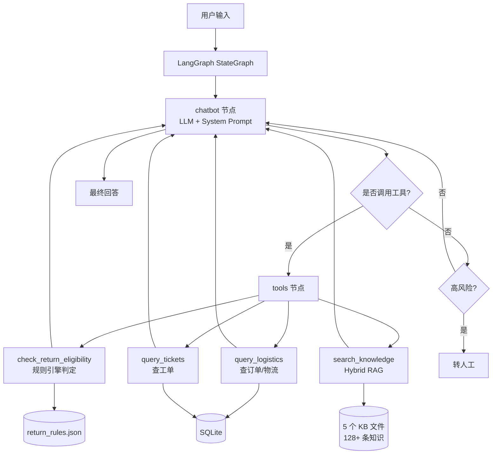

# 电商售后 Agent

> 基于 LangGraph + Hybrid RAG 的电商售后智能客服 Agent，覆盖物流查询、退货退款、争议处理、发货规则、评价规则 5 大场景。

## 📌 项目简介

本项目是一个完整的电商售后 Agent 原型，不是简单的"调 LLM API"，而是从数据底座、工具层、检索层、规则引擎到评测体系的端到端系统。

核心能力：
- LangGraph 工作流：管理"LLM 决策 → 工具调用 → 观察结果 → 再决策"的执行循环
- Hybrid RAG 检索：BM25 + bge-small-zh 向量检索 + RRF 融合重排
- 规则引擎：12 条结构化规则，支持优先级匹配和精确判定（如"能不能退/运费谁出"）
- 数据标注 Pipeline：从淘宝官方规则原文自动提取结构化 KB，扩充效率提升 10 倍
- 评测驱动迭代：28 条黄金评测集，6 轮迭代，端到端通过率从 40% 提升至 89%

## 🏗️ 架构图



## 📂 项目结构

```
ecommerce_agent/
├── data/
│   ├── kb/                      # 知识库（5 大场景）
│   │   ├── logistics_kb.json    # 物流规范（30 条）
│   │   ├── return_kb.json       # 退货规范（5 条）
│   │   ├── dispute_kb.json      # 争议处理（25 条）
│   │   ├── shipping_kb.json     # 发货规范（38 条）
│   │   └── review_kb.json       # 评价规范（30 条）
│   ├── rules/                   # 规则库（结构化判定）
│   │   ├── return_rules.json    # 退货规则（12 条）
│   │   └── logistics_rules.json # 物流规则（2 条）
│   ├── orders/                  # 场景化订单数据
│   └── eval/
│       └── golden.jsonl         # 28 条黄金评测集
├── scripts/
│   └── extract_kb.py            # 数据标注 Skill
├── tests/
│   ├── check_data.py            # 数据完整性检查
│   └── run_eval.py              # 自动评测脚本
├── agent.py                     # LangGraph 主流程
├── db_tools.py                  # 工具层（4 个工具）
├── init_db.py                   # 数据库初始化
└── requirements.txt
```

## 🔧 技术栈

| 层 | 选型 | 说明 |
|---|---|---|
| 语言/框架 | Python 3.14 + LangGraph | Agent 工作流 |
| LLM | DeepSeek API | 决策与生成 |
| 向量模型 | bge-small-zh-v1.5 | 中文语义检索 |
| 关键词检索 | BM25 + jieba | 精确匹配 |
| 融合重排 | RRF (k=60) | BM25 + 向量结果融合 |
| 数据存储 | SQLite | 订单、物流轨迹、工单 |
| 数据标注 | 自研 Skill + DeepSeek | 从规则文本提取 KB |

## 📊 评测结果

构建了 **28 条黄金评测集**，覆盖物流查询、退换货、政策咨询、多意图、拼写错误、情绪化投诉 6 类场景。

| 轮次 | 通过率 | 关键改动 |
|---|---|---|
| 第 1 轮 | 11/28 (40%) | 基线 |
| 第 2 轮 | 20/28 (71%) | 扩充 KB 同义词 + 5 条 Prompt 强制规则 |
| 第 3 轮 | 20/28 (71%) | 数据库补 4 字段（金额/包邮/签收时间/退款状态）+ query_tickets 工具 |
| 第 4 轮 | 25/28 (89%) | 精细化 Prompt：情绪阈值、包邮字段利用、签收天数自算 |
| 第 5 轮 | 23/28 (82%) | 规则引擎上线，发现新退化（政策咨询类） |
| 第 6 轮 | 25/28 (89%) | 修复规则 J：区分"通用政策咨询"与"具体订单问题" |

**最终成绩**：
- 端到端任务成功率：**89%**
- 高风险场景（情绪安抚、转人工）：**100%**
- 无幻觉率：**100%**（28 条用例全部无编造）

## 🧩 核心技术亮点

### 1. Hybrid RAG 检索

- 问题：纯关键词检索遇"内裤拆封"，知识库写的是"贴身用品"，无法召回
- 方案：BM25 + bge-small-zh 向量检索并行，用 RRF 融合重排
- 效果：长尾语义问题召回率从 0% 提升至 100%

### 2. 规则引擎（优先级匹配）

- 问题：同一订单可能命中多条规则，需要精确判定优先级
- 方案：采用 priority 降序排序，规则按 priority 遍历匹配
- 优先级设计：
  - `999` 强制转人工
  - `120` 质量问题允许退货（不受任何限制）
  - `115` 特殊类目未发货可取消
  - `110` 特殊类目拒绝无理由
  - `100` 未发货直接退款
  - `90` 超 7 天拒绝
  - `80` 运费判定

### 3. 数据标注 Skill

- 问题：手工整理知识库效率低，网页文本噪声多
- 方案：自研 `extract_kb.py`，实现"预清洗 → 分段提取 → 合并去重 → 字段校验 → ID 冲突扫描 → 自动入库"完整 Pipeline
- 效果：单页规则扩充耗时从 30 分钟降至 3 分钟

## 🚀 快速开始

```bash
# 1. 安装依赖
pip install -r requirements.txt

# 2. 配置 API Key（在项目根目录创建 .env）
echo "DEEPSEEK_API_KEY=sk-your-key" > .env

# 3. 初始化数据库
python init_db.py

# 4. 运行评测
python tests/run_eval.py
```

## 🎯 面试要点

1. **为什么用 Hybrid RAG 而非纯向量？**
   - 纯向量在"专有名词/实体"上会丢失精度（如订单号），BM25 补充精确匹配能力

2. **规则引擎的优先级怎么设计？**
   - 按业务逻辑定：质量问题不受任何限制（120）；特殊类目只拒绝"无理由退货"（110），不拒绝"质量问题"

3. **数据驱动迭代怎么做？**
   - 每轮评测后记录失败用例 → 分类根因（数据/规则/Prompt）→ 定向修复 → 复跑验证

4. **你遇到的最大技术难点？**
   - 短 Query 检索失败：用户问"定制品能退吗"（6 字），高频词"退"稀释了 BM25 权重，向量相似度也不聚焦，导致正确的 KB 被挤出 top3。解决方案：把知识标题改成问答式（"定制类商品能退吗？"），让知识本身携带高频用户词汇。

## 📄 License

本项目仅用于个人学习与作品展示，未做商业用途。数据来源于淘宝官方规则中心的公开规则文本。

## 📮 联系方式

- GitHub: yunweitang28-ux
- Email: 2509966759@qq.com